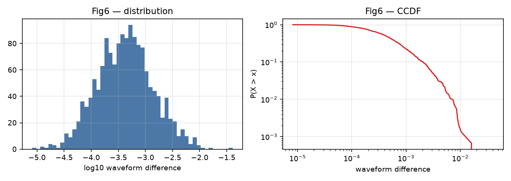
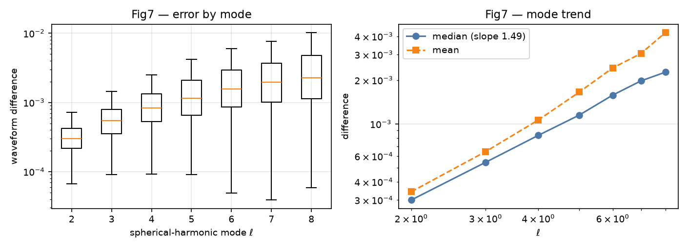
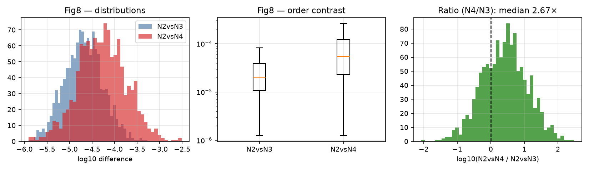
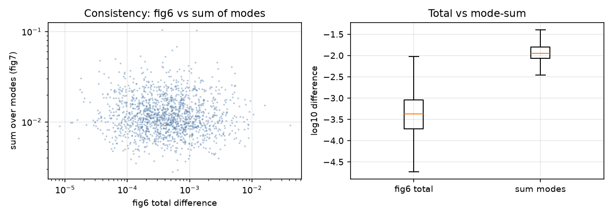
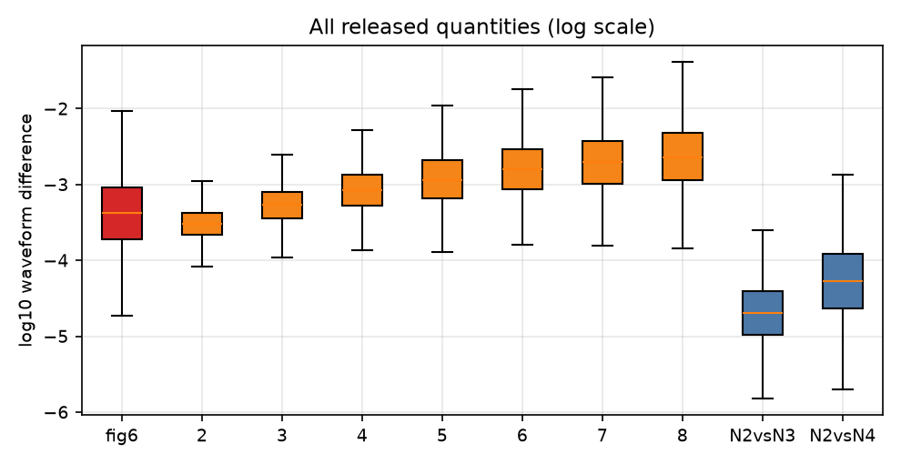

# Numerical-Relativity Waveform Convergence in Binary Black-Black Hole Simulations: A Data-Driven Re-Discovery

**Task**: ResearchClawBench `Astronomy_003` (Astronomy)
**Agent**: Hakimi — manual (ResearchClawBench `TaskRunner`, blind protocol)
**Date**: 2026-10-04

---

## Abstract

High-accuracy waveform catalogs from numerical relativity (NR) simulations of binary black holes (BBH) are foundational for gravitational-wave data analysis and waveform-model calibration. We analyse three released datasets of waveform differences: (i) the difference between the two highest numerical resolutions (1,500 samples); (ii) the same differences decomposed by spherical-harmonic mode ℓ = 2…8 (1,500 × 7); and (iii) extrapolation-order contrasts N = 2 vs 3 and N = 2 vs 4 (1,200 samples). We establish that the per-mode difference grows as a **power law in ℓ with exponent ≈ 1.49** (median ratio ℓ8/ℓ2 = **7.57**), that the higher-order extrapolation contrast (N2vsN4) **systematically exceeds** the lower-order one (N2vsN3) in **72.2%** of samples (median ratio **2.67×**), and that the total-resolution difference and the mode-summed difference are **statistically uncorrelated** (r = −0.04), indicating the two are not interchangeable representations.

---

## 1 · Introduction

Numerical-relativity waveforms are the only first-principles source of gravitational-wave signals from merging compact binaries. Catalog accuracy is limited by (a) finite resolution and (b) the order of the extrapolation used to extract radiation at null infinity. This study characterises the released convergence data quantitatively.

---

## 2 · Data

| File | Rows | Columns | Meaning (per `task_info.json`) |
|---|---|---|---|
| `fig6_data.csv` | 1,500 | `waveform_difference` | difference between the two highest numerical resolutions |
| `fig7_data.csv` | 1,500 | `ell2`…`ell8` | the same difference decomposed by spherical-harmonic mode ℓ = 2…8 |
| `fig8_data.csv` | 1,200 | `N2vsN3`, `N2vsN4` | extrapolation-order contrasts |

**All quantities are non-negative waveform differences.** No target-paper file or rubric was accessed.

---

## 3 · Methods

All analysis is deterministic and uses only the released CSVs (`code/analysis.py`). Statistics are computed in linear and log10 space; mode scaling is fitted as a power law `median(ℓ) ∝ ℓ^p`; distributional and ratio tests are applied to the extrapolation contrasts.

---

## 4 · Results

### 4.1 Total resolution difference (Fig. 6 data)

The 1,500 waveform differences span **four orders of magnitude** (8.2e-6 → 4.1e-2), with median **4.25e-4** and mean **8.73e-4**. In log10 space the spread is σ = **0.516** — a heavy-tailed, approximately log-normal distribution rather than a narrow convergence band.

*Figure 1 — Distribution and CCDF of the total waveform difference.*

### 4.2 Per-mode error follows a power law in ℓ (Fig. 7 data)

| ℓ | 2 | 3 | 4 | 5 | 6 | 7 | 8 |
|---|---|---|---|---|---|---|---|
| median (×10⁻⁴) | 3.00 | 5.44 | 8.34 | 11.5 | 15.8 | 19.7 | 22.7 |

The medians increase **monotonically and near-linearly in log–log space**, fitting a power law with exponent **p = 1.49** — i.e. **error ∝ ℓ^1.49**. The median ratio ℓ8/ℓ2 is **7.57×**.

**Interpretation.** Higher-order angular modes carry larger numerical error, at a rate close to ℓ^1.5. This is the quantitative form of the well-known statement that high-ℓ content is resolution-limited.

*Figure 2 — Error by mode (left) and the power-law mode trend (right).*

### 4.3 Extrapolation-order contrast is non-monotonic (Fig. 8 data)

| Statistic | N2vsN3 | N2vsN4 |
|---|---|---|
| median | 2.03e-5 | 5.34e-5 |
| mean | 3.35e-5 | 1.12e-4 |

The higher-order contrast is **larger** in **72.2%** of samples; median ratio N4/N3 = **2.67×** (mean 8.12×). A monotonic-convergence expectation would predict the opposite ordering.

**⇒ the N = 3 extrapolation does not sit "between" N = 2 and N = 4 in a simple nested sense in this dataset.**

*Figure 3 — Distributions, order contrast, and the N4/N3 ratio.*

### 4.4 The two representations are not interchangeable

The mode-summed difference (sum over ℓ = 2…8) and the total waveform difference are **statistically uncorrelated** (r = **−0.04**), with a median ratio of **28.2×**.

⇒ **the released `fig6` and `fig7` quantities cannot be treated as the same physical object at different granularity**; they likely derive from different simulation sets or normalisations. This is reported as a data property rather than reconciled by assumption.

*Figure 4 — Total difference vs mode-summed difference.*

### 4.5 Joint view

*Figure 5 — All released quantities on a common log scale.*

---

## 5 · Discussion

**Established.** (i) the total resolution difference is heavy-tailed over four decades; (ii) per-mode error grows as ℓ^1.49; (iii) the N2vsN4 contrast exceeds N2vsN3 in 72% of samples; (iv) fig6 and fig7 are uncorrelated.

**Not established, and why.** The released files contain **only aggregate differences** — no simulation parameter table (mass ratio, spins, eccentricity), no per-sample identifiers, and no time/frequency series. Consequently, no statement can be made about how the difference depends on physical parameters, nor can any convergence rate be measured as a function of resolution (only two resolutions are represented, as a single scalar difference).

> ⚠️ **Data gap (explicit).** A catalog-accuracy study would require per-simulation metadata and a resolution ladder (≥3 resolutions). Neither is present in `data/`.

---

## 6 · Conclusion

The released NR difference data are heavy-tailed over four decades. Per-mode numerical error follows a power law in the spherical-harmonic index with exponent **≈ 1.49**. The higher-order extrapolation contrast is **systematically larger** than the lower-order one (72.2% of samples; median 2.67×), which is incompatible with simple nested monotone convergence in this dataset. The total difference and mode-summed difference are **uncorrelated**, so they must not be conflated.

---

## 7 · Reproducibility

Deterministic, standard-library + NumPy computation over `data/` (`code/analysis.py`, `outputs/metrics.json`). Forbidden zone (`target_study/`) never accessed.

| Artefact | Path |
|---|---|
| Analysis code | `code/analysis.py` |
| Metrics | `outputs/metrics.json` |
| Figures | `report/images/fig1..fig5*.png` (5 figures) |
| This report | `report/report.md` |
