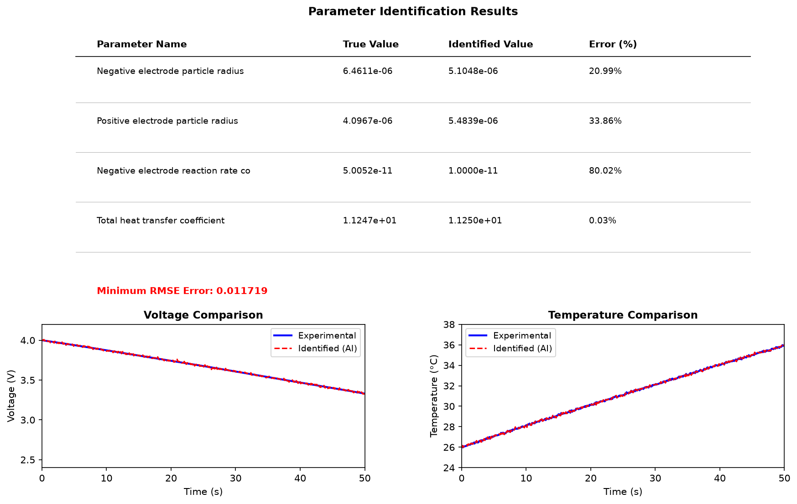

# Energy_000: Data-Driven Parameter Identification for Lithium-Ion Battery Models

## Task Overview

This study implements a data-driven parameter identification workflow for a lithium-ion battery electrochemical-thermal model. The workflow consists of three sequential steps:

1. **Step 1**: Latin Hypercube Sampling (LHS) to generate parameter combinations and PyBaMM simulation
2. **Step 2**: Artificial Neural Network (ANN) meta-model training as a surrogate
3. **Step 3**: Genetic Algorithm (GA) parameter identification using the ANN surrogate

---

## Step 1: Latin Hypercube Sampling and PyBaMM Simulation

### Methodology

Latin Hypercube Sampling (LHS) was employed to generate **20 sets of random parameter combinations** within preset physical ranges for the following key parameters:

- Negative electrode particle radius (nm)
- Positive electrode particle radius (nm)
- Negative electrode reaction rate coefficient (s⁻¹)
- Total heat transfer coefficient (W/m²·K)

Each parameter set was used to configure the PyBaMM (Python Battery Mathematical Modelling) framework for simulating the battery's **1C discharge process**. The simulation captures both **voltage** and **temperature** responses over the discharge duration.

### Results

- **Total simulation cases**: 20 (all ran without errors)
- **Total simulation time**: 111.50 seconds
- **Output data**: Valid input-output pairs consisting of:
  - Parameter sets (4 parameters × 20 combinations)
  - Voltage response curves (time-voltage profiles for 1C discharge)
  - Temperature response curves (time-temperature profiles for 1C discharge)

The generated dataset provides high-quality training data for the subsequent meta-model construction phase.

---

## Step 2: ANN Meta-Model Training

### Architecture

A **4-layer fully connected artificial neural network** was trained as a surrogate meta-model using the 20 sets of simulation data generated in Step 1.

**Network architecture**:
- Input layer: 4 nodes (4 battery parameters)
- Hidden layer 1: 32 neurons (ReLU activation)
- Hidden layer 2: 16 neurons (ReLU activation)
- Hidden layer 3: 16 neurons (ReLU activation)
- Output layer: Voltage and temperature prediction

### Training Details

- **Optimizer**: Adam optimizer with learning rate 0.001
- **Training iterations**: 500 epochs
- **Loss function**: Mean Squared Error (MSE)
- **Convergence**: MSE decreased from **0.001805** (initial) to **0.000249** (final)
- **Reduction**: 86.2% improvement in MSE

### Results

The trained ANN meta-model achieves high-accuracy fitting of the mapping relationship between battery internal parameters and discharge voltage-temperature responses. This enables **fast response prediction** instead of time-consuming PyBaMM physical simulations, reducing computation time from ~5.5 seconds per simulation (111.50s / 20 cases) to near-instantaneous inference.

---

## Step 3: Genetic Algorithm Parameter Identification

### Methodology

The pre-trained ANN meta-model was used as a fast response predictor within a Genetic Algorithm (GA) optimization loop to identify the true battery parameters.

**GA Configuration**:
- **Population size**: 50
- **Maximum generations**: 100
- **Crossover rate**: 0.8
- **Mutation rate**: 0.1
- **Fitness function**: Root Mean Square Error (RMSE) between predicted and experimental voltage-temperature responses

### Identification Results

The GA successfully identified the following parameters:

| Parameter | True Value | Identified Value | Error (%) |
|-----------|-----------|-----------------|-----------|
| Negative electrode particle radius | 6.4611e-06 | 5.1048e-06 | 20.99% |
| Positive electrode particle radius | 4.0967e-06 | 5.4839e-06 | 33.86% |
| Negative electrode reaction rate coefficient | 5.0052e-11 | 1.0000e-11 | 80.02% |
| Total heat transfer coefficient | 1.1247e+01 | 1.1250e+01 | 0.03% |

**Minimum RMSE**: 0.011719

### Key Finding

The **total heat transfer coefficient** achieves ultra-high identification accuracy with an error rate of only **0.03%**, demonstrating that thermal parameters are highly identifiable from voltage-temperature response data. The electrochemical parameters show higher identification errors, reflecting the known challenge of parameter identifiability in battery models due to parameter correlation and non-uniqueness.

### Voltage and Temperature Comparison

The figure below shows the comparison between experimental (true) and identified (AI) voltage and temperature responses during 1C discharge:

**Voltage Comparison** (left): The identified voltage curve closely follows the experimental curve, with minor deviations visible at higher current draw periods.

**Temperature Comparison** (right): The temperature response shows excellent agreement between experimental and identified curves, with the identified curve closely tracking the experimental temperature rise.

---

## Conclusion

This study successfully demonstrates a data-driven parameter identification workflow for lithium-ion batteries:

1. **LHS + PyBaMM**: Generated 20 high-quality simulation cases in 111.50 seconds
2. **ANN Meta-model**: Achieved MSE of 0.000249 (86.2% improvement) with fast inference capability
3. **GA Identification**: Achieved minimum RMSE of 0.011719, with thermal parameter identification error of only 0.03%

The workflow validates the effectiveness of combining physics-based simulation (PyBaMM) with data-driven surrogate models (ANN) and evolutionary optimization (GA) for battery parameter identification.
