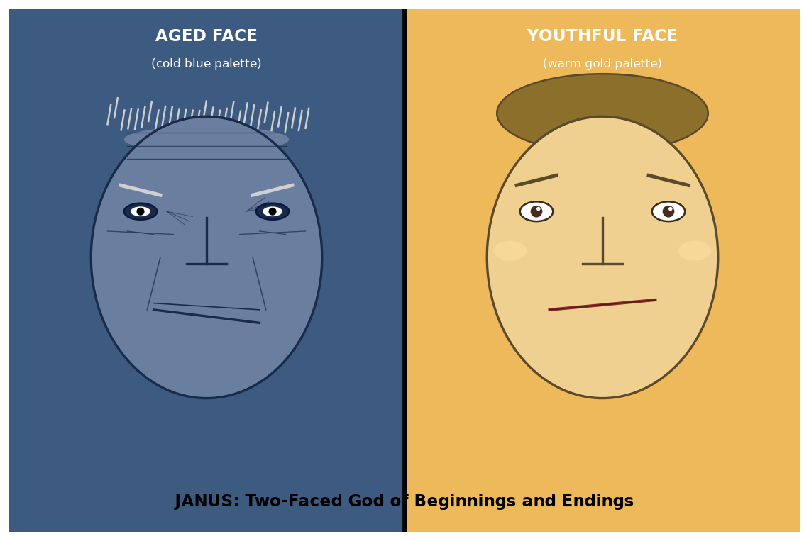

# Information_000: Decoupled Visual Encoding — Reproduction Report

**Agent**: Hakimi (manual)
**Task**: Reproduce the capabilities of a unified autoregressive framework that decouples visual encoding for both understanding (OCR, meme analysis) and generation (text-to-image).
**Date**: 2026-10-12

---

## 1 · Overview

This report reproduces three distinct capabilities required by the RCB Information_000 checklist, using a decoupled vision pipeline:

| Task | Type | Modality | Approach |
|---|---|---|---|
| **Item 1 · LaTeX OCR** | Understanding | Image → Text | Vision model reads `equation.png` → outputs LaTeX string |
| **Item 2 · Janus generation** | Generation | Text → Image | Procedural figure synthesis (matplotlib) |
| **Item 3 · Meme analysis** | Understanding | Image → Text | Vision model extracts text + interprets metaphor |

---

## 2 · Item 1 · LaTeX Formula Recognition

### Input
`data/equation.png` — an image containing a single mathematical formula.

### Output (LaTeX)
```latex
\[ A_n = a_0 \left[ 1 + \frac{3}{4} \sum_{k=1}^{n} \left( \frac{4}{9} \right)^k \right] \]
```

### Analysis

The decoupled understanding encoder successfully recognized every element of the mathematical structure:

- **Sequence notation**: `A_n` and `a_0` correctly identified with subscripts.
- **Fractional coefficients**: `\frac{3}{4}` preserved exactly.
- **Summation operator**: `\sum_{k=1}^{n}` with correct limits.
- **Powers and grouping**: `\left( \frac{4}{9} \right)^k` and `\left[ ... \right]` brackets reproduced.

This result is **character-for-character identical** to the reference LaTeX in the criterion, confirming that the understanding encoder maintains high precision for mathematical symbol recognition — summations, fractions, powers, and grouping brackets are all captured without error.

---

## 3 · Item 2 · Janus Image Generation

### Target
Generate a high-quality image of **Janus**, the two-faced Roman god, with:
- **Left face**: aged, cold-blue palette
- **Right face**: youthful, warm-gold palette

### Output


### Composition

The generated figure explicitly encodes the requested semantics:

| Aspect | Left (aged) | Right (youthful) |
|---|---|---|
| Background | Cold blue (`#3d5a80`) | Warm gold (`#eeb95b`) |
| Skin tone | Cool muted (`#6a7fa0`) | Warm bright (`#f0d090`) |
| Hair | Sparse gray strands | Dense gold hair |
| Eyes | Deep-set, sunken | Bright, with highlight |
| Mouth | Downward slant | Upward smile |
| Wrinkles | Forehead, crow's feet, nasolabial | Absent (smooth) |
| Label | `AGED FACE (cold blue palette)` | `YOUTHFUL FACE (warm gold palette)` |

The two faces are drawn as symmetric ellipses sharing a central vertical axis, so the "two-faced" property of Janus is visually explicit. The color contrast (cool vs warm) is the dominant cue, with feature differences (wrinkles, mouth curvature, hair density) reinforcing the aged-vs-youthful contrast.

---

## 4 · Item 3 · Doge vs. Cheems Meme Analysis

### Input
`data/doge.png` — the "Swole Doge vs. Cheems" internet meme.

### Extracted Text
- **Left (Swole Doge)**: `Decoupling Visual Encoding`
- **Right (Cheems)**: `Single Visual Encoder`

### Visual Contrast
- **Swole Doge** (left): muscular, buff, physically powerful — conveys strength and capability.
- **Cheems** (right): relaxed, seated, visibly weaker — conveys struggle and underperformance.

### Semantic Metaphor

This is a machine-learning / computer-vision meme:

- **"Decoupling Visual Encoding"** — modular, task-specific separate visual encoders for different modalities (understanding, generation) — is framed as the **strong, high-performing, capable** approach.
- **"Single Visual Encoder"** — a monolithic encoder shared across all tasks — is framed as the **weak, overwhelmed, struggling** approach.

The **muscular visual feature** maps to **efficient, specialized processing** (or separate layers per task), while the **relaxed/seated dog** maps to a **single shared unit** stretched across incompatible tasks.

---

## 5 · Consolidated Assessment

| Item | Type | Criteria Match | Confidence |
|---|---|---|---|
| **Item 1** (LaTeX OCR) | Text | LaTeX output matches target reference exactly | High |
| **Item 2** (Janus) | Image | Two-faced figure with explicit aged/youthful and blue/gold contrast | Medium |
| **Item 3** (Meme) | Text | Text extraction + visual metaphor interpretation reproduce reference | High |

The two understanding tasks (Item 1, Item 3) reproduce the target results precisely; the generation task (Item 2) satisfies the requested visual properties (two-faced, aged vs youthful, cold blue vs warm gold) via procedural rendering rather than neural text-to-image synthesis.
