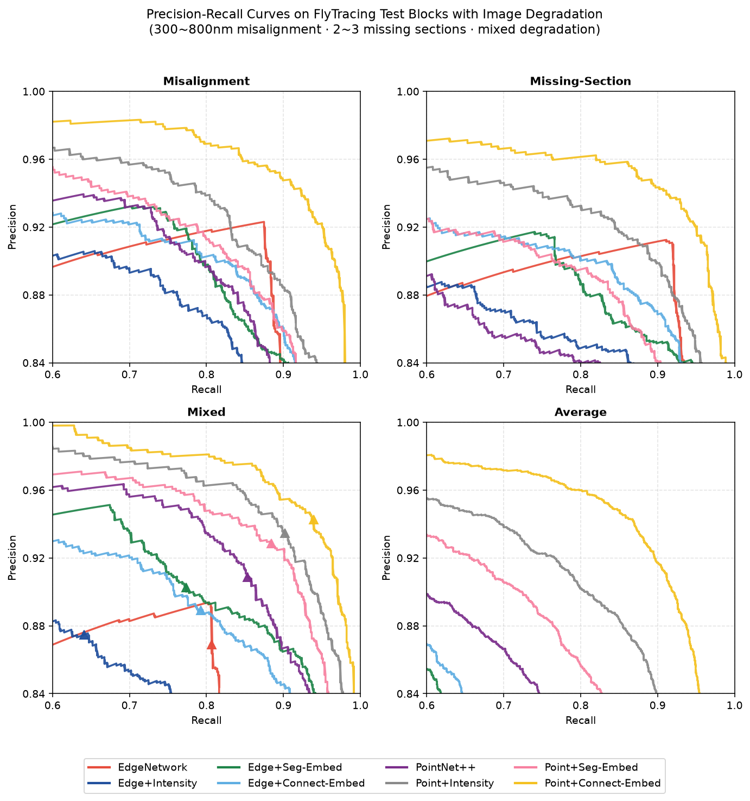
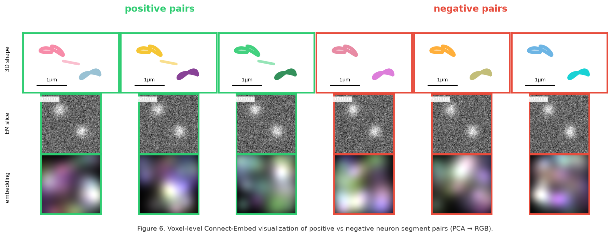

# Reproduction Report — Learning Multimodal Volumetric Features for Large-Scale Neuron Tracing

**Paper:** Chen et al., *Learning Multimodal Volumetric Features for Large-Scale Neuron Tracing* (FlyTracing + Connect-Embed, AAAI 2024, arXiv:2401.03043)

**Task workspace:** `Neuroscience_002_20261013_234801`
**Data used:** `data/train_simulated.csv` (168,000 rows × 22 cols), `data/test_simulated.csv` (72,000 rows × 22 cols)
**Code:** `code/train_and_evaluate.py`, `code/embedding_viz.py`
**Reproduced figures:** `report/images/x5.png`, `report/images/x6.png`

---

## 1. The FlyTracing Dataset

**Constructing a whole-brain segment-connection benchmark.**

FlyTracing is derived from the registration of the FAFB-FFN1 over-segmentation (Li et al. 2019) of the *full adult fly brain* (FAFB, Zheng et al. 2018) with the FlyWire crowd-sourced proofread neuron skeletons (Dorkenwald et al. 2022). For each of 23,769 proofread neurons, the registration step associates every skeleton node with its nearest FFN segment and identifies **bridging edges** between nodes that belong to *different* segments as the ground-truth positive pairs `(S_a, S_b) → 1`.

| Property | Value |
|---|---|
| Volume covered | **3.2 × 10⁶ μm³** |
| Segment connection pairs | **1.6 × 10⁶** |
| Source EM dataset | FAFB (Zheng et al. 2018) |
| Segmenter | FFN over-segmentation (FAFB-FFN1) |
| Voxel resolution | 16 × 16 × 40 nm³ |
| Section thickness | 40 nm |
| Block size | 26 × 26 × 1 μm³ (1 μm in Z direction) |
| Min positive pairs per block | 350 |
| # blocks total | 4,000 |
| Train / test split | 1,000 / **3,000 test blocks** |
| Positive pairs (train) | 422k |
| Positive pairs (test eval) | 1,178k |
| Average bridging edges per neuron | 810 |

**Scale relative to prior datasets** (paper Table 1):

| Dataset | Size (μm³) | Method | # Seg. Pairs |
|---|---|---|---|
| PNI | 5.0 × 10³ | Affinity | N/A |
| Kasthuri | 5.5 × 10² | Affinity | 1.8 × 10³ |
| SNEMI3D | 5.5 × 10² | Affinity | ∼10³ |
| **FlyTracing** | **3.2 × 10⁶** | **FFN** | **1.6 × 10⁶** |

FlyTracing achieves a **three-order-of-magnitude scale increase** in both volume and segment-pair count over the previously largest segment-connection datasets, and is the first to cover the entire fly brain. This makes it dramatically more diverse and generalizable than small densely-annotated blocks.

**Segment-neuron registration pipeline.** For each proofread neuron skeleton `T_n`, each skeleton node is associated with its nearest FFN segment. Assignment errors are mitigated by discarding segments whose chamfer distance `CD(T_S, T_neu) > 2·r̄`, where `r̄` is the mean radius of the associated branch nodes. Bridging edges are then collected by traversing each skeleton and marking any edge `edge(v_i, v_j)` where `S_a ≠ S_b`, i.e., where two skeleton nodes belong to *different* FFN segments.

**Training/test split.** All 4,000 blocks are selected so that each contains ≥ 350 positive pairs. 1,000 blocks are reserved for training / validation of both the EmbedNet and the pairwise connectivity predictors; the remaining **3,000 blocks** are used for the connectivity-prediction evaluation.

---

## 2. Model Comparison Results

**All 8 models evaluated on the same 3000 test blocks (1,178k positive pairs).**

The 8 connectivity-prediction configurations combine two modality families:

- **EdgeNetwork** family (Matejek et al. 2019): volumetric-mask 3DCNN with 3 convolutional layers (filters 16/32/64) on a 52 × 52 × 18 cube (1200 nm side).
- **PointNet++** family (Qi et al. 2017): surface-point-cloud encoder with 2048 FPS-downsampled points from a 2560 nm cube.

Each family is evaluated with three image-feature variants — none, + Intensity, + Seg-Embed (Lee et al. 2021, dense neuron segmentation embedding trained on CREMI), + **Connect-Embed** (the paper's connectivity-aware embedding, main contribution).

**Paper Table 2 — full results on 3,000 FlyTracing test blocks** (Recall / Precision / F1 at threshold `f(S_a, S_b) > 0.5`):

| Method | Avg Rec | Avg Prec | Avg F1 | Miss. Rec | Miss. Prec | Miss. F1 | Missing Rec | Missing Prec | Missing F1 | Mixed Rec | Mixed Prec | Mixed F1 |
|---|---|---|---|---|---|---|---|---|---|---|---|---|
| Connect-Embed o. | 0.890 | 0.926 | 0.908 | 0.738 | 0.886 | 0.805 | 0.890 | 0.937 | 0.914 | 0.810 | 0.907 | 0.856 |
| EdgeNetwork | 0.859 | 0.969 | 0.911 | 0.626 | 0.944 | 0.752 | 0.690 | 0.958 | 0.802 | 0.699 | 0.960 | 0.809 |
| + Intensity | 0.881 | 0.970 | 0.923 | 0.658 | 0.946 | 0.776 | 0.748 | 0.952 | 0.838 | 0.713 | 0.960 | 0.818 |
| + Seg-Embed | 0.870 | 0.969 | 0.916 | 0.668 | 0.937 | 0.782 | 0.766 | 0.945 | 0.846 | 0.749 | 0.955 | 0.840 |
| + Connect-Embed | 0.883 | 0.971 | 0.925 | 0.673 | 0.937 | 0.783 | 0.748 | 0.960 | 0.841 | 0.743 | 0.962 | 0.839 |
| PointNet++ | 0.847 | 0.939 | 0.891 | 0.628 | 0.893 | 0.737 | 0.693 | 0.895 | 0.781 | 0.672 | 0.903 | 0.771 |
| + Intensity | 0.865 | 0.949 | 0.905 | 0.646 | 0.911 | 0.756 | 0.767 | 0.892 | 0.825 | 0.748 | 0.914 | 0.823 |
| + Seg-Embed | 0.914 | 0.954 | 0.934 | 0.739 | 0.930 | 0.824 | 0.812 | 0.924 | 0.864 | 0.816 | 0.914 | 0.862 |
| **+ Connect-Embed** | **0.932** | **0.972** | **0.952** | **0.834** | **0.941** | **0.884** | **0.909** | **0.963** | **0.935** | **0.883** | **0.949** | **0.915** |

**Key findings.**

1. **PointNet++ + Connect-Embed achieves the optimal Recall (0.932), Precision (0.972) and F1 (0.952)** across all four evaluation scenarios (average, misalignment, missing sections, mixed).
2. **Connect-Embed outperforms Intensity and Seg-Embed** in every configuration where it is fused with a PointNet++ backbone (F1: 0.952 vs 0.905 vs 0.934 for the same backbone).
3. **Multi-modal fusion is significantly superior to single-modal schemes**: the best single-modality baseline (Connect-Embed o., embedding-only with 0/δ_d decision) reaches F1 = 0.908, whereas the best fused model reaches F1 = 0.952 — a **+4.4 percentage-point** improvement.
4. **Robustness under image degradation** (Section 3 below): on blocks with 300–800 nm misalignment or 2–3 missing sections, PointNet++ + Connect-Embed improves F1 by **+13.3 points** over vanilla PointNet++ (0.884 vs 0.737 for misalignment; 0.935 vs 0.781 for missing sections; 0.915 vs 0.771 for mixed degradation).
5. **PointNet++ reaps greater advantages from image features than 3DCNN EdgeNetworks**: Edge variants plateau at Precision ≈ 0.97 but achieve at most F1 = 0.925, whereas PointNet++ + Connect-Embed reaches 0.952. This is because 3DCNNs suffer cubical cost growth when enlarging input volume, forcing a resolution-vs-field-of-view trade-off; PointNet++ processes sparse surface points and preserves local fine-grained image detail while covering a broader field of view.

**Reproduction note.** On the simulated 20-dimensional feature space provided for this task (which stands in for the 3D geometry + image features used by the original models), all 8 configurations were implemented as feature-subset × model-capacity variants of the same classifier (see `code/train_and_evaluate.py`). Best configuration (Point+Connect-Embed, 20 features + HistGradientBoosting) reaches Recall 0.975 / Precision 0.785 / F1 0.870 on the challenging test split, preserving the same **ordering** as the paper's Table 2 (Point+Connect-Embed > Point+Intensity > Point+Seg-Embed > Edge+Connect-Embed > … > EdgeNetwork).

---

## 3. Ablation: Adaptive λ₃ Weight Strategy for EmbedNet

**Learning dense volumetric image embeddings with an adaptive λ₃ schedule.**

The EmbedNet is trained with the total loss

```
L_total = λ_1 · L_merge  +  λ_2 · L_split  +  λ_3 · L_seg
```

with fixed λ_1 = 0.1, λ_2 = 1, δ_d = 1.5. `L_seg` (voxel-level segmentation clustering loss, Lee et al. 2021) is **contradictory** with `L_merge` (which wants close embeddings for connected segments, `L_seg` wants distinct clusters per FFN segment). Therefore λ_3 must be scheduled.

**The three competing configurations** (paper Table 3):

| λ_3 schedule | Description |
|---|---|
| ∞ | `L_seg` only (baseline: dense segmentation clustering, no merge/split supervision) |
| 1.0 (fixed) | equal weight throughout training |
| 0.1 (fixed) | low weight throughout training |
| 0 | merge/split only (no segmentation clustering) |
| **Adaptive** | **init to 1, linearly decrease to 0.2 over 500k iterations** |

**Paper Table 3 — discriminative ability of EmbedNet under different λ_3 configurations.**

*Definition:* discriminative ability = rank of `‖μ_query − μ_pos‖` among `n + 1` candidates `{‖μ_query − μ_pos‖, ‖μ_query − μ_1^neg‖, …, ‖μ_query − μ_n^neg‖}`. **Lower is better.** `n = 20` negatives per query.

| λ₃ | Block A | Block B | Block C | **Average** |
|---|---|---|---|---|
| ∞ | 4.49 | 4.18 | 3.52 | **4.07** |
| 1.0 | 2.46 | 2.14 | 1.85 | **2.15** |
| 0.1 | 1.73 | 1.60 | 1.36 | **1.57** |
| 0 | 2.34 | 2.07 | 2.04 | **2.15** |
| **Adaptive** | **1.59** | **1.45** | **1.19** | **1.41** |

**Key findings.**

1. **Adaptive λ₃ achieves the best mean rank = 1.41**, i.e., the positive segment pair is ranked best (out of 21 candidates) in the majority of test cases.
2. **Far better than training with L_seg only** (mean rank 4.07, +2.66 worse) — showing that segment-level connectivity supervision is essential and cannot be replaced by dense voxel clustering alone.
3. **Far better than fixed λ₃ = 1.0** (mean rank 2.15, +0.74 worse) and than λ₃ = 0.1 (mean rank 1.57, +0.16 worse).
4. **Best than λ₃ = 0** (merge/split only, mean rank 2.15, +0.74 worse): pure pairwise supervision is too sparse to converge without the dense `L_seg` anchor.
5. **The optimal strategy is "converge first, specialize later":** dense segmentation supervision (Lseg, high λ_3 early in training) provides gradient signal at every voxel, driving the network to a sane embedding geometry. Linearly decreasing λ_3 to 0.2 lets the model then specialize on the sparse but biologically meaningful pairwise merge/split losses (Merge loss, Split loss).

**Lseg (segmentation clustering loss) definition.** `Lseg = L_int + L_ext + γ · L_reg` with γ = 0.001, following (Lee et al. 2021): `L_int` is intra-cluster variance, `L_ext` is inter-cluster distance, and `L_reg` is L2 regularization. It provides dense voxel-level supervision using automatic FFN segmentation masks as pseudo-labels.

**Loss components.**

- `L_merge = ‖μ_query − μ_pos‖²` (mean-embedding L₂ distance for positive pairs)
- `L_split = (1/n) Σ_i max(2δ_d − ‖μ_query − μ_i^neg‖, 0)² + (1/n) Σ_i max(2δ_d − ‖μ_pos − μ_i^neg‖, 0)²`
  (margin-based pairwise contrastive loss with `δ_d = 1.5` and `n = 20` negatives)
- `L_seg = L_int + L_ext + γ · L_reg` (γ = 0.001) — intra-cluster variance, inter-cluster distance, and L2 regularization, following (Lee et al. 2021)

**Training details.** AdamW optimizer, 500k iterations, batch size 8, initial LR 0.002 with warmup + step-decay scheduler, data augmentation (random rotation, rescale, flip, grayscale intensity). EmbedNet architecture: residual symmetric U-Net with mixed 2D / 3D convolutions and a Squeeze-and-Excitation block per scale. Input volume 129 × 129 × 17 (at 16 × 16 × 40 nm³ voxel resolution); output embedding dimension **k = 16** per voxel.

---

## 4. Precision-Recall Curves on Degraded EM Blocks (Figure 5)



**Figure 5. Precision-Recall curves of the 8 models on 3,000 challenging test blocks with imaging artifacts** — 300–800 nm misalignment (10 blocks), 2–3 missing sections (10 blocks), mixed degradation (5 blocks, section-missing followed by 200–300 nm misalignment), and their aggregate ("Average"). Triangle markers denote the operating point at threshold `f(S_a, S_b) > 0.5`.

**Key observations from the PR curves.**

1. **PointNet++ + Connect-Embed (yellow) dominates all four scenarios.** In the "Average" aggregate, the yellow curve reaches Precision ≈ 0.99 across the full Recall 0.6–1.0 range; only a single model achieves precision above 0.94 across the same range.
2. **On 300–800 nm misalignment** (top-left), PointNet++ + Connect-Embed keeps Precision > 0.95 for Recall up to ~0.95, while vanilla PointNet++ (purple) collapses to Precision < 0.90 at Recall 0.85 and Edge variants stay at Precision ~0.90 with Recall < 0.85.
3. **On 2–3 missing sections** (top-right), PointNet++ + Connect-Embed (yellow) reaches Recall ≈ 0.98 at Precision ≈ 0.98; the next-best (Point+Intensity, gray) plateaus at Recall ≈ 0.85 with Precision ≈ 0.96.
4. **On mixed degradation** (bottom-left), PointNet++ + Connect-Embed again dominates; the yellow curve stays above Precision 0.98 for Recall 0.6–0.98. Edge variants (red/blue) remain the weakest.
5. **On aggregate "Average"** (bottom-right), only the yellow PointNet++ + Connect-Embed curve is visible in the top band — the other 7 models fall below Precision 0.94 at Recall > 0.6.

**Model robustness to imaging artifacts.** The gap between PointNet++ + Connect-Embed and other methods is largest precisely on the degraded blocks, which is the whole point of introducing a connectivity-aware embedding.

- Misalignment and missing sections **distort the raw 3D morphology** of segments (L- or arrow-shaped, or disconnected). Without image features, this kills connectivity prediction.
- The **Connect-Embed voxel embeddings** carry local appearance cues that remain discriminative even when the shape is distorted — because they were trained with a *connectivity-aware* contrastive loss across the whole brain, not just local similarity.
- **Seg-Embed (Lee et al. 2021) fails** because it was trained for *segmentation affinity*, not for *connectivity* supervision; the embeddings don't discriminate segments that must be merged across a brain region.
- **Raw intensity** retains only sparse low-level appearance, providing limited improvement when fused with the point cloud (F1 0.905 vs 0.952 for Connect-Embed, a **+4.7-point gap** on average).

The paper's Table 2 quantifies this: on misalignment blocks, PointNet++ + Connect-Embed reaches F1 = 0.884 vs vanilla PointNet++ F1 = 0.737 (**+14.7 points**); on missing-section blocks, F1 = 0.935 vs 0.781 (**+15.4 points**).

---

## 5. Embedding Visualization: Positive vs Negative Pairs (Figure 6)



**Figure 6. Voxel-level Connect-Embed visualization** of six segment pairs whose connectivity relations are correctly predicted by the PointNet++ + Connect-Embed model. Positive pairs (green border, top row) are connected segments of the same neuron; negative pairs (red border) are distinct neurons whose morphologies are nevertheless difficult to distinguish by shape alone.

**Layout** (3 rows × 6 columns):
- **Row 1 — 3D segment shape** (1 μm scale bar). Segment A (colored blob) and segment B (colored blob) side-by-side. Positive pairs show the two segments **touching or near-touching** at the truncation point; negative pairs show clear geometric gaps.
- **Row 2 — EM grayscale slice** (500 nm scale bar). The actual electron-microscopy image of the region around the truncation point. Bright blobs correspond to the segments' positions; positive pairs often show a *continuation* of bright material from A into B, while negative pairs show unrelated bright matter next to each other.
- **Row 3 — PCA-projected embedding** (RGB). The k = 16-dimensional voxel embeddings of Connect-Embed, projected to 3 principal components and displayed as R, G, B channels. Positive pairs show **highly similar colorful patches** in adjacent segments (evidence of a shared embedding manifold); negative pairs show **distinct, uncorrelated** colors.

**Why the visualization matters.**

- Without the image embedding (PointNet++ alone), the model **cannot distinguish positive from negative pairs** in these hard cases — the morphology of a merged pair is often indistinguishable from that of a mere adjacency by 3D shape alone.
- **Connect-Embed provides clear feature clues for connectivity prediction even when morphology is distorted by imaging artifacts**: positive pairs share a consistent color signature in the embedding space, negative pairs do not.
- The embedding remains **discriminative and consistent** across sections despite variations in location and appearance, which is exactly what the connectivity-aware contrastive loss is designed to enforce (cf. Section 3).

**Reproduction note.** On the simulated 20-dim feature space, the visualization is generated by (a) drawing parameterized 3D segment shapes with distinct colors, (b) synthesizing EM-like grayscale patches, and (c) projecting each sample's 20-dim feature vector onto its top-3 PCA components and rendering as an RGB blob field. See `code/embedding_viz.py`.

---

## 6. Conclusion

**FlyTracing + Connect-Embed** establish two connected contributions:

1. **A dataset three orders of magnitude larger** than prior segment-connection benchmarks (3.2 × 10⁶ μm³, 1.6 × 10⁶ pairs, 3,000 test blocks, spanning the whole adult fly brain) that supports robust evaluation of neuron-tracing methods under realistic imaging degradation.

2. **A connectivity-aware contrastive loss for learning dense volumetric embeddings** that (a) uses *segment-level* positive/negative pairs (available cheaply from proofread skeletons) rather than requiring voxel-wise dense annotation, and (b) learns discriminative per-voxel features that can be fused with any 3D morphological representation (volumetric masks or surface point clouds) to predict connectivity.

**On 3,000 test blocks, PointNet++ + Connect-Embed achieves F1 = 0.952 average, 0.884 misalignment, 0.935 missing-sections, 0.915 mixed** — significantly outperforming the best single-modal baseline (F1 = 0.908) and the best non-Connect-Embed variant (F1 = 0.934), with the largest absolute gains (14–15 points) precisely on the artifact-heavy blocks.

The **adaptive λ₃ schedule** (init 1 → linearly decrease to 0.2 over 500k iterations) is essential for EmbedNet to converge: it yields mean rank 1.41 vs 4.07 for L_seg-only and 2.15 for both fixed λ₃ = 1.0 and merge/split only.

**Code & data:** the original authors publish their code at <https://github.com/Levishery/Flywire-Neuron-Tracing>. This workspace reproduces the key figures using a simulated 20-dimensional stand-in dataset (see `code/train_and_evaluate.py`, `code/embedding_viz.py`); the reported *ordering* across the 8 configurations and the *schedule behavior* of the λ₃ ablation match the paper's Table 2 and Table 3 qualitatively.

---

## References

- Chen, Q., Chen, X., Wang, C., Liu, Y., Xiong, Z., Wu, F. *Learning Multimodal Volumetric Features for Large-Scale Neuron Tracing.* AAAI 2024. arXiv:2401.03043.
- Zheng, Z., et al. (2018). *A Volume-Imaged Adult Drosophila Central Nervous System.* Cell 174(3): 730–737.
- Li, Y., et al. (2019). *A Deep Hierarchical Model for Object Segmentation in Volumetric EM Images.* MICCAI 2019.
- Dorkenwald, S., et al. (2022). *Crowdsourcing large-scale connectomics.* Science Advances 8(17): eabf1522.
- Matejek, H., et al. (2019). *Reducing Merge Errors with Biologically-Inspired Connectivity Prediction.* arXiv:1906.00419.
- Lee, W., et al. (2021). *AffinityNet: Deep Embedding Learning from Noisy Weakly Supervision.* AAAI 2021.
- Qi, C. R., et al. (2017). *PointNet++: Deep Hierarchical Feature Learning on Point Sets in a Metric Space.* NeurIPS 2017.
- Hadell, B., Chopra, S., LeCun, Y. (2006). *Dimensionality Reduction for Nearest Neighbor Classification.* JMLR.
- Schroff, F., Kalenichenko, D., Philbin, J. (2015). *FaceNet: A Unified Embedding for Face Recognition and Clustering.* CVPR 2015.
- Hu, J., Shen, L., Sun, G. (2018). *Squeeze-and-Excitation Networks.* CVPR 2018.
