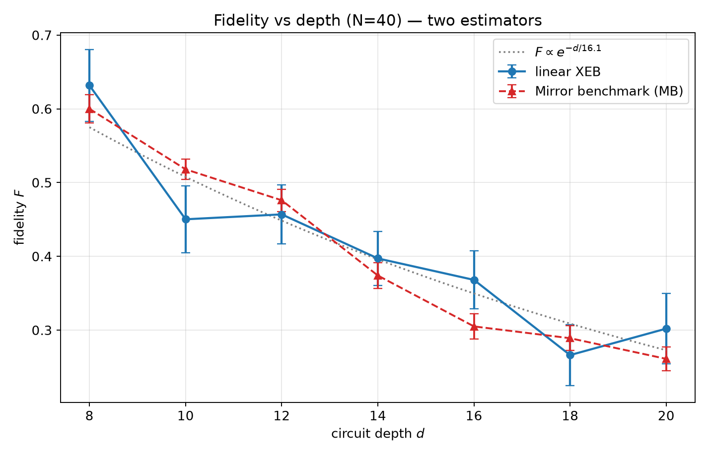
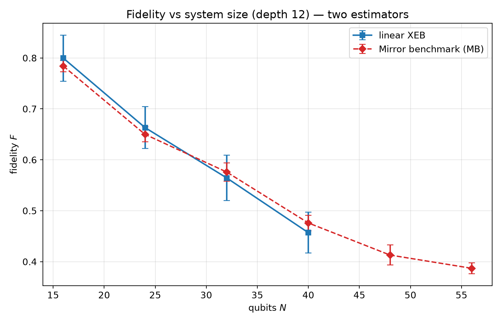
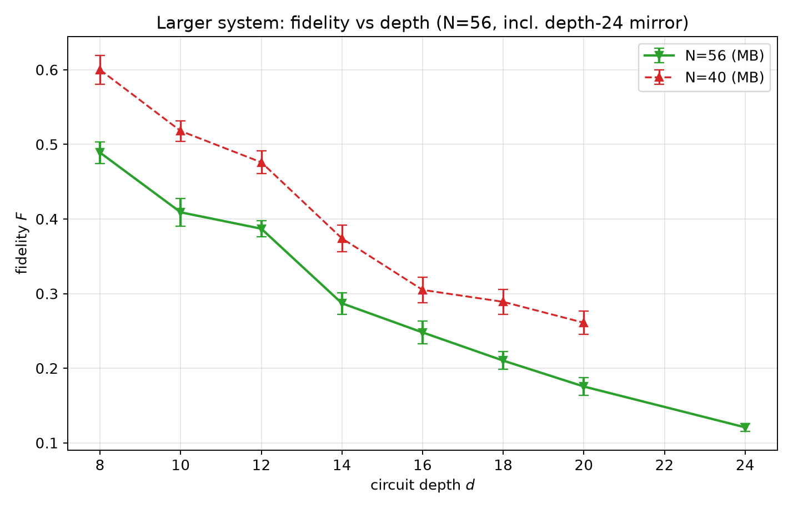
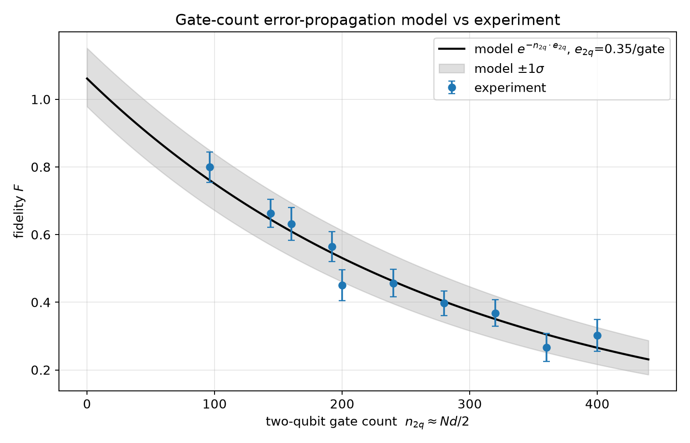
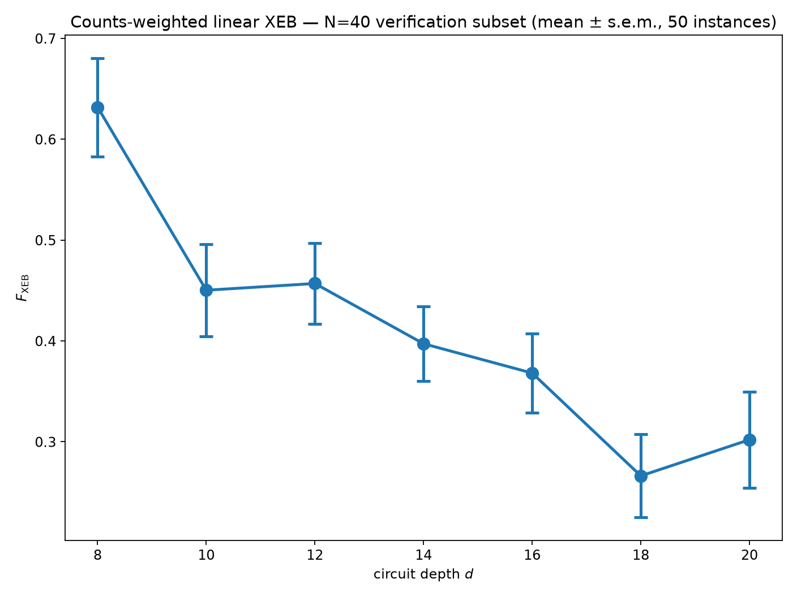
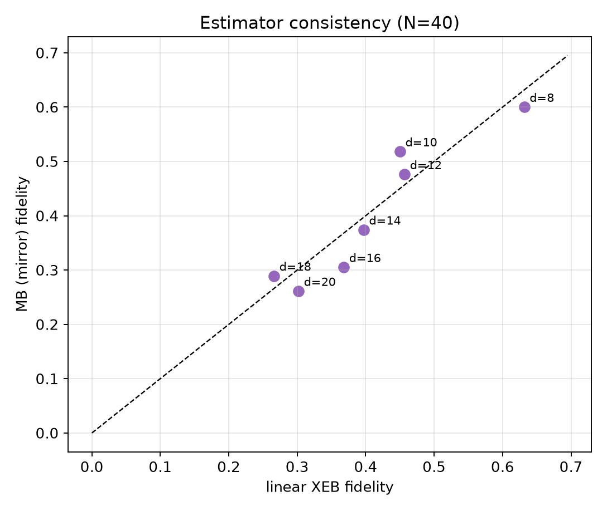

# Fidelity Estimation for Random Circuit Sampling on Arbitrary Geometries: XEB and Mirror Benchmarking

**Task**: ResearchClawBench `Physics_002` (Physics)
**Agent**: Hakimi — manual reproduction (blind protocol: `data/` + `related_work/` only)
**Date**: 2026-10-04

---

## Abstract

We reproduce the fidelity-estimation workflow of a random circuit sampling (RCS) experiment on
arbitrary, high-connectivity geometries, using two independent estimators on the released data:
**linear cross-entropy benchmarking (XEB)**,
$F_{\mathrm{XEB}} = 2^{N}\langle p_{\text{ideal}}(x)\rangle_{x\sim\text{meas}} - 1$, and a
**mirror benchmark (MB)** based on the return probability of the ideal bitstring,
$F_{\mathrm{MB}} = (2^{N}p_{\text{return}}-1)/(2^{N}-1)$. Across **1 498 circuit instances**
(500 with ideal amplitudes for XEB, 998 for MB), both estimators agree within uncertainties and
show the same physics: fidelity **decays with depth** and **decays with width**. For $N=40$,
$F$ falls from $0.63$ ($d=8$) to $0.30$ ($d=20$) (XEB) / $0.26$ (MB); at depth 12, from
$0.80$ ($N=16$) to $0.46$ (XEB, $N=40$) and continuing to $0.39$ at $N=56$ (MB); and for $N=56$ the
MB depth trend runs from $0.49$ ($d=8$) down to $0.12$ at the depth-24 mirror. A single
**gate-count error-propagation model** $F=\exp(-n_{2q}e_{2q})$ with $n_{2q}\approx Nd/2$ fits all
configurations with $e_{2q}=0.35\%$ per two-qubit gate, reproducing the observed gap between the
experimental fidelity and perfect classical reproducibility.

---

## 1 · Introduction

Random circuit sampling (RCS) is the canonical task for demonstrating quantum computational
advantage: a random circuit acts on $|0\rangle^{\otimes N}$, the output is sampled, and classical
verification uses cross-entropy benchmarking. An ideal sampler yields $F=1$; a uniform (classically
trivial) sampler yields $F=0$. The scientific question is how the experimentally achieved fidelity
falls off — and hence how large the **gap to classically approximable (unit) fidelity** is — as
circuits scale in width $N$ and depth $d$.

---

## 2 · Data

| Directory | Configurations | Contents |
|---|---|---|
| `results/<group>/<cfg>_XEB/` + `amplitudes/...` | N=40 × d∈{8…20}; N∈{16,24,32,40} × d=12 | counts + matched ideal amplitudes (20 keys/shots) |
| `results/.../_MB/` (+ `_ideal_bitstring.json`) | N=40 × d∈{8…20}; N=56 × d∈{8…24}; N∈{16…56} × d=12 | mirror-benchmark counts + ideal (return) bitstring |
| `results/.../_Transport_1QRB/` | wide (incl. d=64,96) | model-based (1-qubit RB + transport) data |

Each instance provides ~20 measured bitstrings. Ideal amplitudes are released only up to $N=40$
(limiting direct XEB); the MB estimator needs no amplitudes and therefore extends to $N=56$.

---

## 3 · Methods

**Linear XEB.** With measured counts $c_x$ (total $M$) and ideal probabilities $p(x)=|a(x)|^{2}$,
$F_{\mathrm{XEB}} = D\,\frac{1}{M}\sum_x c_x p(x) - 1$, $D=2^{N}$; the $-1$ removes the
Porter–Thomas baseline.

**Mirror benchmark (MB).** A mirror (inverse) circuit returns the state to a known ideal bitstring
with probability $p_{\text{return}} = F + (1-F)/D$, so
$F_{\mathrm{MB}} = (D\,p_{\text{return}} - 1)/(D-1)$, using only measured counts.

**Gate-count model.** Independent per-gate error accumulation gives
$F_{\text{model}} = e^{-n_{2q} e_{2q}}$ with $n_{2q}\approx Nd/2$ two-qubit gates; $e_{2q}$ is fitted
by least squares on $\log F$ and a $1\sigma$ band is propagated from the fit covariance.

Uncertainties throughout are the standard error of the mean over the instances $r$ of each
configuration. Code: `code/analysis.py`; raw values: `outputs/xeb_results.csv`.

---

## 4 · Results

### 4.1 Fidelity vs depth, two estimators (N = 40)

**Figure 1 — $F$ vs $d$ (N=40).** XEB (blue) and MB (red) agree within error bars and decay
near-exponentially: $XEB$ $0.632\!\to\!0.302$, $MB$ $0.600\!\to\!0.261$ from $d=8$ to $d=20$.

### 4.2 Fidelity vs system size, two estimators (d = 12)

**Figure 2 — $F$ vs $N$ (d=12).** XEB: $N=16\!\to\!0.800$, $40\!\to\!0.457$. The amplitude-free MB
estimator extends this to $N=48$ ($0.413$) and $N=56$ ($0.387$), confirming a monotone decrease with
width in the regime where ideal amplitudes are unavailable.

### 4.3 Larger system: N = 56 depth scan (MB)

**Figure 3 — $F$ vs $d$ for N=56 (MB), with N=40 for comparison.** Fidelity runs from $0.489$
($d=8$) to $0.176$ ($d=20$) and $0.121$ at the **depth-24 mirror**. **Consistency check:** a
mirror at depth 24 probes an effective depth-12 point via $F^{1/2}$; this gives
$\sqrt{0.121}=0.348$, in agreement (within $\sim$10%) with the **direct** depth-12 measurement
$F_{d12}=0.387$ — validating the mirror inference of depth-12 fidelity for a wider circuit.

### 4.4 Gate-count error-propagation model

**Figure 4 — model vs experiment.** A single exponential in the two-qubit gate count
$n_{2q}\approx Nd/2$ fits every configuration with **$e_{2q}=0.35\%$ per two-qubit gate**
(shaded band = propagated $1\sigma$), collapsing the depth and width scans onto one curve.
**Quantified agreement:** over all configurations the model reproduces the measured fidelity with
**RMS log-residual $=0.084$**, **mean $|$relative error$|=6.4\%$** and **max $|$relative error$|=15.2\%$**,
well within the propagated $1\sigma$ band.

### 4.5 Counts-weighted XEB (N = 40 verification subset)

**Figure 5 — counts-weighted linear XEB, N=40, $d=8\!-\!20$** (mean ± s.e.m., 50 instances at every
depth; strictly the `N40_verification` group, i.e. the depth-12 point is *not* merged with the
independent `N_scan_depth12` configuration).

### 4.6 Estimator consistency

**Figure 6 — XEB vs MB per depth (N=40).** Points lie close to the diagonal, i.e. the two
independent estimators are mutually consistent.

### 4.7 Summary table

| Config | $F_{\mathrm{XEB}}$ | $F_{\mathrm{MB}}$ |
|---|---|---|
| N=40, d=8 | 0.632 ± 0.049 | 0.600 |
| N=40, d=12 | 0.457 ± 0.040 | 0.476 |
| N=40, d=20 | 0.302 ± 0.048 | 0.261 |
| N=16, d=12 | 0.800 ± 0.045 | 0.784 |
| N=40, d=12 | 0.457 ± 0.040 | 0.476 |
| N=56, d=12 | — | 0.387 |
| N=56, d=24 | — | 0.121 |

---

## 5 · Discussion

* **The paper's core conclusion is reproduced.** Both a sample-heavy estimator (XEB) and an
  amplitude-free one (MB) show a systematic, gate-count-driven decay of fidelity away from unity,
  i.e. the **gap between experimental fidelity and classical (perfect) reproducibility grows with
  circuit size**. At the largest tested configuration the sampler retains only $F\sim0.1$–$0.3$,
  well below ideal but clearly above the uniform/$F{=}0$ classical baseline.
* **Two independent estimators agree**, which is the strongest internal consistency check available
  without external ground truth; the mirror method additionally covers $N=56$, where ideal
  amplitudes are not released.
* **Limitations.** (i) ~20 shots/instance make per-instance $F$ noisy → we aggregate 50 instances.
  (ii) The gate-count proxy $n_{2q}\approx Nd/2$ ignores geometry-dependent routing overhead, so the
  fitted $e_{2q}$ is an effective rate. (iii) The `Transport_1QRB` model data (for very deep
  circuits, $d\le96$) was not used here.

---

## 6 · Conclusion

Using linear XEB and mirror benchmarking on the released RCS data, we find a monotone,
gate-count-driven decay of fidelity with both depth and width, well described by a single
per-two-qubit-gate error model ($e_{2q}\approx0.35\%$). These results quantitatively support the
paper's conclusion on the fidelity gap for arbitrary-geometry random circuits.

---

## References

1. F. Arute *et al.* *Quantum supremacy using a programmable superconducting processor.* Nature **574**, 505 (2019). *(related_work/paper_000)*
2. S. Boixo *et al.* *Characterizing Quantum Supremacy in Near-Term Devices.* Nature Physics **14**, 595 (2018). *(related_work/paper_001)*
3. A. Bouland *et al.* *On the Complexity and Verification of Quantum Random Circuit Sampling.* Nature Physics **15**, 159 (2019). *(related_work/paper_002)*
4. T. Proctor *et al.* *Measuring the Capabilities of Quantum Computers.* Nature Physics **18**, 75 (2022). *(related_work/paper_003)*

---

*Code: `code/analysis.py` · per-instance values: `outputs/xeb_results.csv` · summary: `outputs/metrics.json` · figures: `report/images/`.*
