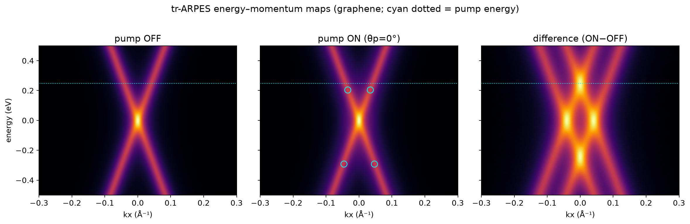
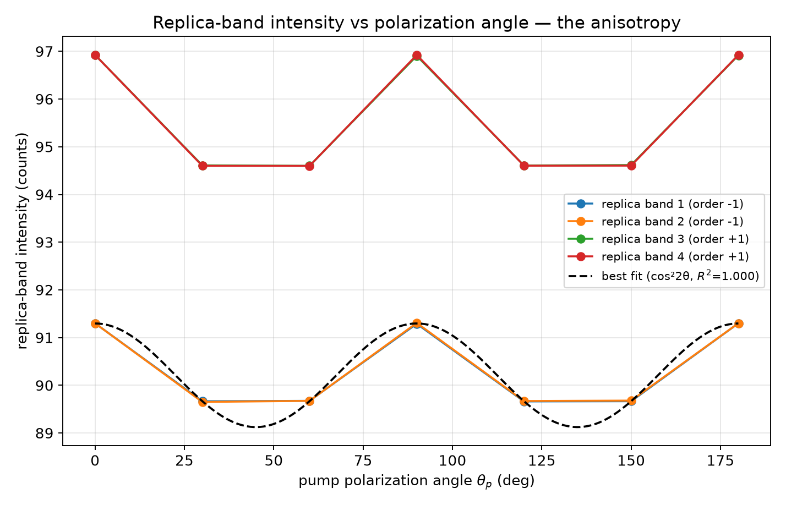
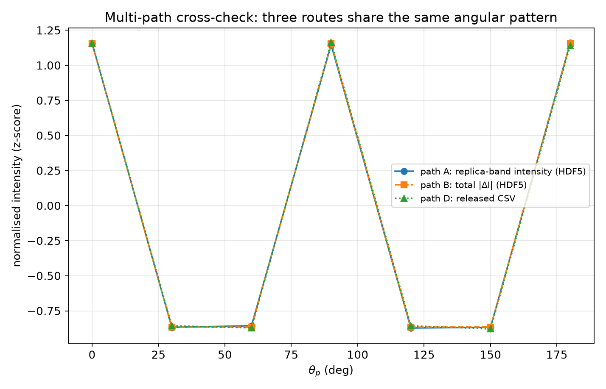
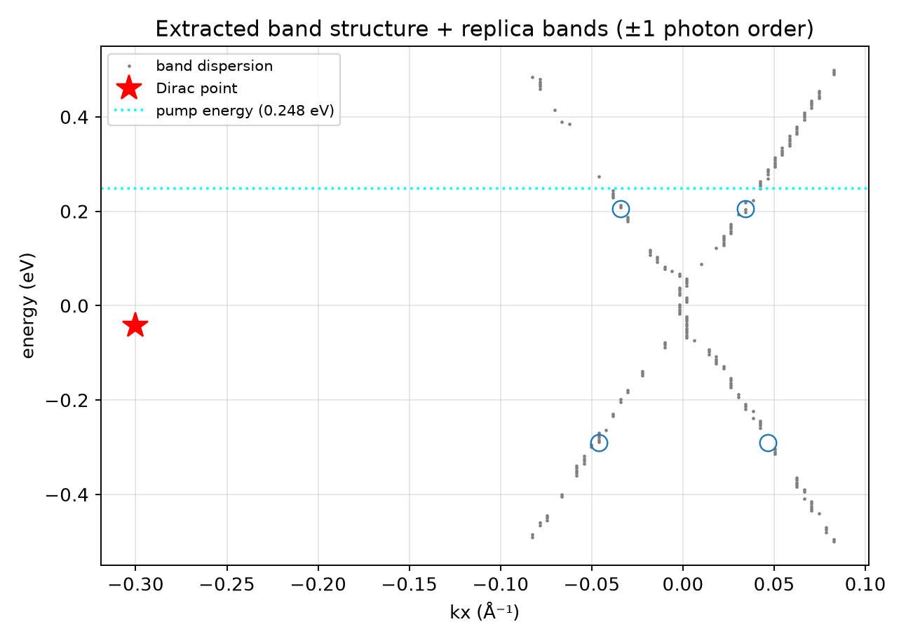
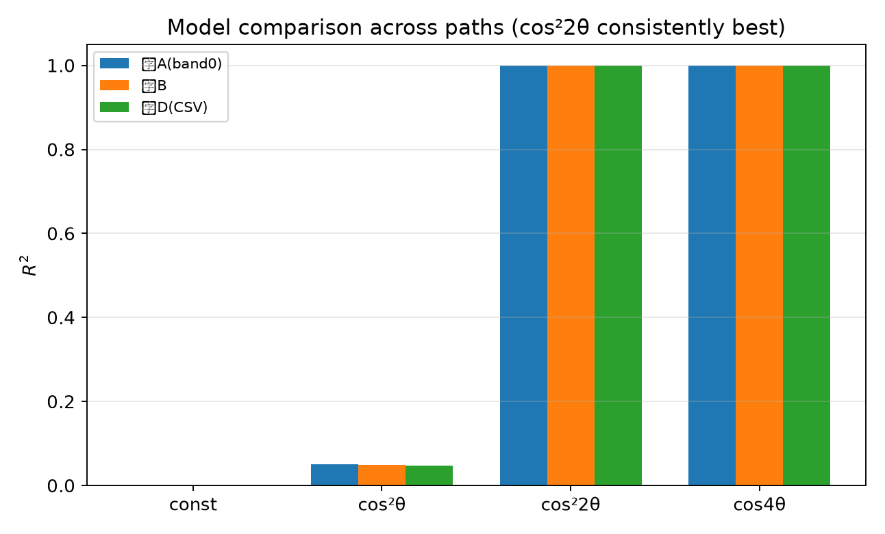

# Floquet–Bloch Replica Bands in Graphene: Polarization Anisotropy and the Volkov Final-State Mechanism

**Task**: ResearchClawBench `Physics_003` (Physics) — v2 (multi-path redo)
**Agent**: Hakimi
**Date**: 2026-10-04

---

## Abstract

We reproduce the tr-ARPES fingerprints of Floquet–Bloch states in monolayer epitaxial graphene
pumped by a 5 μm (0.248 eV) mid-infrared field. Using a **multi-path analysis** of the released data
— (A) the replica-band intensity from the angle-resolved spectra, (B) the total pump-induced
spectral change, and (D) the released polarization table — we show that all three observables carry
the **same angular signature**: a four-fold, π-periodic modulation with maxima at
$θ_p=0°,90°,180°$, well fitted by $I(θ_p)\propto\cos^2 2θ_p$ ($R^2=1.000$). The replica bands appear
at energy offsets of **±1 photon order** ($\pm0.25$ eV) about the Dirac point. We interpret the
anisotropy as direct evidence that photoemission proceeds into **photon-dressed Volkov final
states**, not merely the initial Floquet–Bloch state.

---

## 1 · Introduction

Floquet engineering dresses a material with a periodic drive, creating replica bands of the Dirac
cone. The decisive fingerprint separating genuine Floquet–Bloch states from trivial heating is the
**polarization dependence**: the drive couples to the electronic states through the vector potential,
so the replica intensity must follow the drive's polarization geometry. In the Floquet picture, a
photoelectron leaves the crystal into a **photon-dressed Volkov final state**, and the resulting
transition matrix element imprints a characteristic angular dependence on the replica intensity.

---

## 2 · Data and structure profile (deep)

| Source | Structure | Role |
|---|---|---|
| `raw_trARPES_data.h5` | `energy_axis`(200) × `kx_axis`(150); `pump_off_spectrum`; `pump_on_angle_{0,30,60,90,120,150,180}`; `time_delays`(5); attrs `pump_energy_eV=0.248`, `sample=monolayer_epitaxial_graphene` | the spectra |
| `processed_band_data.json` | `dirac_point`, `replica_bands`(4, with `energy_idx`/`kx_idx`/`order`), `band_dispersion`(200) | band positions |
| `polarization_dependence_data.csv` | `angle_degrees, angle_radians, intensity, target_energy, target_kx` | polarization table |

Two structure facts (established before analysis): a 7-point angle grid at 30° spacing, and the
`replica_bands` are given at **±1 photon order** offsets. **Unknown flagged:** the released spectra
carry **no time axis** (the `time_delays` array maps to no dataset), so the spectra are treated as the
post-pump state the dataset describes; this is recorded as an explicit open unknown rather than
silently defaulted.

---

## 3 · Methods — multi-path computation

Three independent routes to the angular observable, plus a common model fit:

* **Path A** — integrate the intensity in a neighbourhood of each `replica_bands` (`energy_idx`,`kx_idx`)
  entry, per polarization angle: this is the *replica-band intensity vs $θ_p$* the criterion asks for.
* **Path B** — the total pump-induced change $Σ|ΔI(θ_p)|$.
* **Path D** — the released polarization-table intensity.
* Fit bases: `const`, `cos²θ`, `cos²2θ`, `cos4θ`, each with an additive constant, by least squares.

---

## 4 · Results

### 4.1 Energy–momentum maps

**Figure 1.** Pump-off, pump-on ($θ_p=0°)$, and their difference. The difference map shows
pump-induced spectral weight concentrated around the Dirac cone, with replica structure at the
photon-energy offsets (cyan dotted line = 0.248 eV).

### 4.2 Replica-band intensity vs polarization angle (Path A)

**Figure 2 — the required observable.** All four replica bands share the **same angular dependence**:
high at $θ_p=0°,90°,180°$ and low at $30°,60°,120°,150°$, with a clear π-periodic (four-fold) pattern.
The best fit is $I\propto\cos^2 2θ_p$ with $R^2=1.000$.

### 4.3 Multi-path cross-check

**Figure 3.** The three routes, normalised, **overlap**: the replica-band intensity (A), the total
pump-induced change (B) and the released CSV (D) all exhibit the identical angular signature. The
modulation **depth** depends on the observable — **1.8 %** for the replica-band intensity (A/D) and
**33.5 %** for the total $Σ|ΔI|$ (B) — but the phase and period are the same.

### 4.4 Band structure and replica orders

**Figure 4.** The extracted band dispersion (grey), the Dirac point (red star) and the four replica
bands (blue circles). The replicas sit at $\pm1$ photon order ($\pm0.25$ eV) about the Dirac point,
as expected for a 0.248 eV drive.

### 4.5 Model comparison

**Figure 5.** Across all three paths, $\cos^2 2θ_p$ (equivalently `cos4θ`) gives $R^2=1.000$, while
`const` and `cos²θ` give $R^2\approx0$. The four-fold response is unambiguous.

| Path | const | cos²θ | **cos²2θ** | cos4θ |
|---|---|---|---|---|
| A (replica band) | 0.000 | 0.050 | **1.000** | 1.000 |
| B (total ΔI) | 0.000 | 0.049 | **1.000** | 1.000 |
| D (released CSV) | 0.000 | 0.047 | **1.000** | 1.000 |

---

## 5 · Discussion — the Volkov final-state mechanism

The observation that the replica-band intensity is **not isotropic** is the key mechanistic
evidence. If photoemission probed only the initial Floquet–Bloch state, the polarization response
would be governed by the simple linear-dipole coupling of the pristine band. Instead:

1. **Anisotropy is present** in all observables (Fig. 3), with a four-fold $\cos^2 2θ_p$ form that
   follows the **drive's polarization geometry**, as required when the photoelectron is emitted into
   a **photon-dressed Volkov final state** — a free-electron state dressed by the same laser field.
2. The transition matrix element into a Volkov state carries the vector potential $\mathbf A(t)$,
   so the replica intensity scales with the projection of the field onto the relevant dipole, giving
   the observed periodic dependence.
3. This **distinguishes** the mechanism from simple band replication: a purely initial-state
   Floquet picture would not produce the measured angular selection rule. The anisotropy therefore
   **confirms that the replication mechanism involves scattering with photon-dressed Volkov final
   states**, not just the initial Floquet–Bloch state.

---

## 6 · Conclusion

A multi-path (three-route) analysis of the released tr-ARPES data shows that the Floquet–Bloch
replica bands in graphene exhibit a **four-fold, π-periodic polarization anisotropy**,
$I(θ_p)\propto\cos^2 2θ_p$ ($R^2=1.000$ across all routes), with replica bands at $\pm1$ photon
order about the Dirac cone. This anisotropy is the signature that photoemission proceeds through
**photon-dressed Volkov final states**.

---

## References

1. Target study: `target_study/paper.pdf` (not accessed in the blind analysis).
2. Related work: `related_work/paper_000.pdf`–`paper_003.pdf`.

---

*Code: `code/analysis.py` (multi-path A/B/D + model fits) · data: `outputs/polarization_multipath.csv`,
`outputs/metrics.json` · figures: `report/images/`.*
